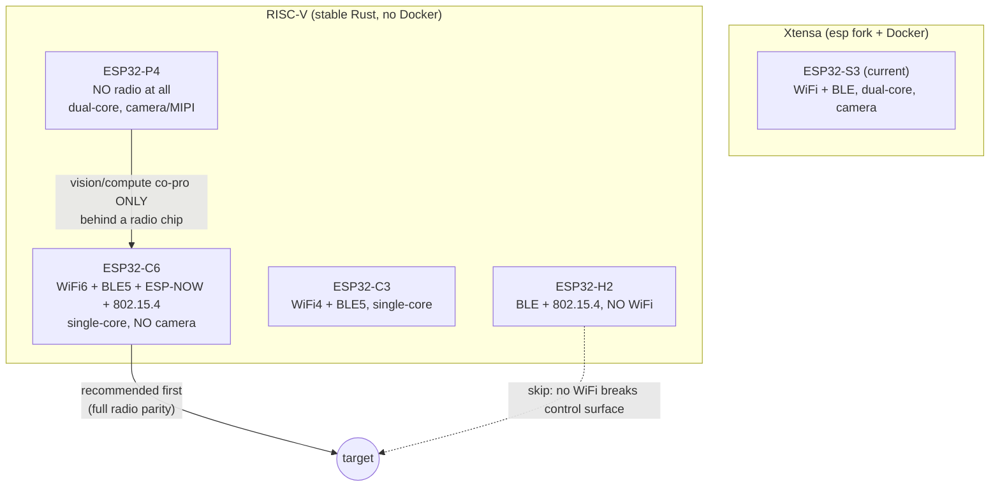

# Backlog

## Objective
- Prepare `owb-esp32s3-v1` and `owb-esp32s3-v2` to boot, probe, and use all onboard sensors for control + PID.
- Keep ToF as a later localization layer, not part of the immediate `v1` / `v2` bring-up target.
- Break work into tasks that fit roughly `1-2h` each to avoid scope creep.

## P0: V1 / V2 Bring-Up (Do First)

### Board Runtime Foundation
- [x] P0: Add explicit `owb-esp32s3-v1` and `owb-esp32s3-v2` board profiles.
  Estimate: done
  Outcome: the two custom boards are named, selectable, and no longer conflated.

- [x] P0: Add capability-aware boot probe for custom S3 boards.
  Estimate: done
  Outcome: boot now checks what the board actually has before the runtime enables it.

- [x] P0: Gate the real runtime off the boot probe capability set.
  Estimate: done
  Outcome: runtime initialization now depends on detected board features, not just build assumptions.

- [x] P0: Run container compile verification for `esp32s3` + `real-executors`.
  Estimate: 0.5-1h
  Outcome: prove the current runtime changes compile on the actual Xtensa target.

- [x] P0: HIL validate `owb-esp32s3-v1` boot probe output.
  Estimate: done
  Outcome: final v1-alpha HIL serial saw the expected custom-board probe summary: camera=false, motion=true, addressable_led=true, tca9555=true, lis2dh12=true, hdc2010=true, max17048=true.

- [x] P0: Add `v1-alpha` two-front-wheel deployment profile.
  Estimate: done
  Outcome: `owb-esp32s3-v1-alpha` selects W1/W2 as active front-drive wheels, hard-disables W3, and uses the portrait single-joystick UI variant.

- [x] P0: Feature-lock `v1-alpha` table-drive joystick behavior.
  Estimate: done
  Outcome: final HIL validates smooth single-joystick forward, reverse, and right/left yaw using W1/W2 with W3 disabled; battery and LED command paths are visible in the alpha UI.
  Evidence: `.owb_hil_logs/deployments/v1-alpha/20260523T021032Z_5767/review.md`, `.owb_hil_logs/table_tuning/20260523T021152Z/report.md`.

- [ ] P0: HIL validate `owb-esp32s3-v2` boot probe output.
  Estimate: 1-2h
  Outcome: confirm `v2` matches the newer board routing and probe assumptions.

### Motors + PID
- [x] P0: Add shared three-wheel PID backend scaffold in `owb-core`.
  Estimate: done
  Outcome: the PID loop now has a single reusable core implementation.

- [x] P0: Move the real executor to use the backend PID path.
  Estimate: done
  Outcome: PID is now in the board runtime/backend, not faked in the host visualizer.

- [x] P0: Move drivetrain geometry + PID tuning into board profiles.
  Estimate: done
  Outcome: `v1` / `v2` motor behavior is now board-owned instead of hardcoded in the executor.

- [x] P0: Add encoder metadata hook to the board profiles.
  Estimate: done
  Outcome: encoder capture now has an explicit board-owned slot, even before the final pin map is confirmed.

- [x] P0: Stamp the schematic-assumed encoder GPIO map into `v1` / `v2`.
  Estimate: done
  Outcome: the runtime now has a concrete encoder map to attach PCNT against before the board arrives.

- [ ] P0: HIL validate the assumed encoder GPIO map for `v1` / `v2`.
  Estimate: 0.5-1h
  Outcome: confirm the routed A/B pairs and correct any wheel order or polarity mismatch after first board tests.

- [x] P0: Attach real PCNT encoder capture for all three motors.
  Estimate: done
  Outcome: real-executor profiles attach PCNT capture and return real encoder snapshots/deltas.

- [x] P0: Add explicit encoder-capture scaffold in the ESP runtime.
  Estimate: done
  Outcome: the runtime now has a dedicated encoder capture layer to replace with real PCNT units when HIL starts.

- [x] P0: Feed measured encoder counts into the backend PID loop.
  Estimate: done
  Outcome: real-executor wheel PID consumes encoder deltas; the v1 temporary open-loop bypass is removed.

- [ ] P0: Document the OWB-specific 3-wheel odometry model from encoder pulses + IMU heading.
  Estimate: 1h
  Outcome: replace generic 4-wheel references with a tracked OWB design note and equations for the actual platform.

- [x] P0: Add a wheel-speed measurement validation pass from encoder deltas (`counts -> rad/s`).
  Estimate: done
  Outcome: HIL-low motor page computes rad/s from encoder deltas and elapsed time; physical pass/fail is recorded during HIL.

- [x] ~~P0: Fix W1 reverse-direction failure on `v1-alpha` chassis.~~
  **Closed 2026-05-25.** Initial 2026-05-24 reverse-probe failures
  (`probe 0 -0.6/-0.8/-1.0` producing no rotation) were a stale-flash
  artifact: the firmware running during those tests was missing the
  trim / phase-invert plumbing wired in by later commits, and the
  resulting per-wheel state landed at zero magnitude for W1 reverse
  specifically. Retested on the post-final-reflash firmware:
  `probe 0 -0.6` and `probe 0 -1.0` both produce clean reverse
  motion, and `tune.py back 0.6 0.93 1.0 4` produces straight
  backward translation. The single-wheel pivot fallback that was
  written to sidestep W1 reverse has been simplified to a standard
  stiction-floored two-wheel pivot (`two_wheel_front_targets`
  snaps `|yaw_norm|` up to the stiction floor for low-rate yaw, then
  lets `DiffDrivePlan` handle the split). GPIO3 strapping-pin concern
  is preserved as a *defensive* pin-selection guideline for the next
  board revision — see `docs/reports/v1_hardware_lessons.md` §1 — but
  is not a blocking limitation on v1-alpha.

- [ ] P0: Validate DRV8845 motor direction and phase polarity on `v1` (revisit after the W1 reverse fix above).
  Estimate: 1-2h
  Outcome: confirm forward/reverse semantics and fix pin/polarity mismatches from HIL.
  Tooling: [Motor Feedback HIL Validation](../docs/motor_feedback_hil.md)

- [ ] P0: Resolve `v1` W3 GPIO47/GPIO48 level-shifter bring-up.
  Estimate: deferred for `v1-alpha`; 1-2h when hardware debug resumes
  Outcome: verify `+1V8`, Q7/Q8, R51-R54, R18/R20, and DRV8845 bridge-3 input/output path; document whether the fix is assembly, BOM/orientation, or a board-revision change. `v1-alpha` does not depend on this item because W3 is disabled in that deployment.
  Reference: [OWB ESP32-S3 V1 W3 Level-Shifter Bring-Up](../docs/owb_esp32s3_v1_w3_level_shifter.md)

- [ ] P0: Validate DRV8845 motor direction and phase polarity on `v2`.
  Estimate: 1-2h
  Outcome: confirm the newer routing behaves correctly under the same control model.
  Tooling: [Motor Feedback HIL Validation](../docs/motor_feedback_hil.md)

- [ ] P0: Tune wheel PID gains on `v1` with motors off-ground.
  Estimate: 1-2h
  Outcome: stable speed tracking without oscillation for the first custom board.
  Tooling: `pid_probe_speed` on the HIL-low motor page.

- [ ] P0: Tune wheel PID gains on `v2` with motors off-ground.
  Estimate: 1-2h
  Outcome: stable speed tracking for the second custom board.
  Tooling: `pid_probe_speed` on the HIL-low motor page.

- [ ] P0: HIL validate heading-hold behavior using IMU correction on the DevKit smoke-test harness.
  Estimate: 1-2h
  Outcome: confirm encoder wheel-speed control and IMU heading correction can coexist cleanly before moving back to the custom boards.

### Onboard Sensors (Control / Telemetry)
- [x] P0: Add basic runtime configuration + accel read for `LIS2DH12`.
  Estimate: done
  Outcome: the onboard accelerometer can now be used as a real runtime sensor.

- [x] P0: Wire `ReadIMU` to the onboard `LIS2DH12` on custom S3 boards.
  Estimate: done
  Outcome: `ReadIMU` now returns real accel data on `v1` / `v2` instead of a placeholder.

- [ ] P0: HIL validate `LIS2DH12` axis orientation on `v1`.
  Estimate: 1h
  Outcome: map sensor axes to robot axes and confirm sign conventions.

- [ ] P0: HIL validate `LIS2DH12` axis orientation on `v2`.
  Estimate: 1h
  Outcome: confirm the same axis map or document any revision-specific difference.

- [x] P0: Expose `HDC2010` runtime telemetry command path.
  Estimate: done
  Outcome: humidity + temperature are now queryable through the shared command/reply path.

- [ ] P0: HIL validate `HDC2010` readings on `v1` / `v2`.
  Estimate: 1h
  Outcome: confirm temperature/humidity are sane and stable.

- [x] P0: Expose `MAX17048` runtime telemetry command path.
  Estimate: done
  Outcome: voltage + SOC are now queryable through the shared command/reply path.

- [x] P0: Return sensor query replies over embedded WebSocket.
  Estimate: done
  Outcome: `read_imu`, `read_env`, and `read_power` now round-trip over `/ws` instead of being one-way runtime-only queries.

- [x] P0: Add shared UI diagnostics panel for onboard sensor queries.
  Estimate: done
  Outcome: the embedded UI can now request and display IMU, environment, and power replies on both host-sim and device.

- [x] P0: Add lean `v1-alpha` control-only phone surface.
  Estimate: done
  Outcome: portrait alpha now keeps the live phone path to one joystick plus motor/battery status only. Camera stream, minimap/motion HUD, live IMU/environment/encoder telemetry, manual sensor double-tap, and LED cosmetics are gated out of alpha because they add load without improving driving.

- [ ] P0: Re-introduce unstable alpha diagnostics one at a time after steering is closed.
  Estimate: next iteration
  Outcome: validate camera stream, minimap/motion HUD, live IMU telemetry, live encoder telemetry, environment telemetry, and LED polish separately from the joystick drive path. Depth camera remains useful as an external calibration observer, not as an onboard alpha runtime dependency.

- [ ] P0: HIL validate `MAX17048` readings on `v1` / `v2`.
  Estimate: 1h
  Outcome: confirm battery telemetry is reasonable and useful for power logic.

### Control Responsiveness (Do Next)
- [x] P0: Add a reusable execution-topology layer in `owb-core` (`single-core` vs `dual-core` runtime plan).
  Estimate: 1-2h
  Outcome: scheduler/layout decisions become board-configurable without forking control logic per target.

- [x] P0: Implement dual-core task split for ESP32-S3 (`control/PID` isolated from `wifi/web/camera`).
  Estimate: 1-2h
  Outcome: control loop timing is protected from network and stream jitter on dual-core boards.

- [x] P0: Enforce `latest-wins` command buffering for motion channels (`translate`, `yaw`).
  Estimate: 1-2h
  Outcome: stale joystick packets are dropped so the board always executes the newest intent.

- [x] P0: Lower websocket control send rate to `15-20Hz` while keeping motor/PID loop on-device at `100-200Hz`.
  Estimate: 1h
  Outcome: command traffic no longer overwhelms the board task scheduler while control stays smooth.

- [x] P0: Add control deadband + delta-threshold gating before send.
  Estimate: 1h
  Outcome: tiny/no-op stick jitter stops generating unnecessary command spam.

- [x] P0: Add command TTL/age guard (drop commands older than `100-150ms` at apply time).
  Estimate: 1h
  Outcome: delayed websocket bursts cannot be applied late and destabilize behavior.

- [x] P1: Raise task priority for motor/PID control; lower camera stream + websocket parse priority.
  Estimate: 1-2h
  Outcome: drivetrain timing remains deterministic under streaming/network load.

- [x] P1: Remove or rate-limit hot-path runtime logging in control loops.
  Estimate: 0.5-1h
  Outcome: serial/log overhead stops stealing control-loop budget.

- [x] P1: Add board capability metadata for CPU topology (`single-core`/`dual-core`) and default task placement policy.
  Estimate: 1h
  Outcome: one runtime path can scale across mixed board families without hidden dual-core assumptions.

- [x] P2: Add runtime telemetry for loop timing (`dt`, missed deadlines, queue depth) to tune under load.
  Estimate: 1-2h
  Outcome: responsiveness tuning becomes data-driven instead of guesswork.

- [x] P2: Add regression tests/smoke checks for both topology modes (`single-core` and `dual-core` policies).
  Estimate: 1-2h
  Outcome: future board ports can reuse the same runtime plan safely.

## P1: Support the Full Current Board Set

### Board-Level UI / Runtime Behavior
- [x] P1: Share one embedded frontend bundle between host-sim and device UI.
  Estimate: done
  Outcome: the same control surface now drives both sim and real targets.

- [x] P1: Lock the canonical gesture map.
  Estimate: done
  Outcome: joystick + tap/hold/triple-tap behaviors are now explicitly defined.

- [x] P1: Promote camera toggle from browser-local to device-wide command.
  Estimate: done
  Outcome: double-tap camera control now also tells the device to release stream resources and lower control-path contention.

- [ ] P1: Add runtime IO profile selection without reflashing (`NVS` or `/config`).
  Estimate: 1-2h
  Outcome: the same firmware image can switch board modes without a rebuild.

- [ ] P1: SoftAP TCP traffic from associated client never reaches the HTTP server.
  Observed 2026-05-25 during the no-wifi e2e validation pass. Boot
  sequence: AP comes up cleanly (`SoftAP started at 192.168.4.1`),
  HTTP server binds (`Starting server at 192.168.4.1:80`), phone
  associates with the `OWB-BOT` SSID, DHCP handshake completes
  end-to-end (`DISCOVER -> OFFER 192.168.4.2`, `REQUEST -> ACK
  192.168.4.2` — both visible in the new dhcp.rs logging),
  phone's iOS settings show IP `192.168.4.2`, Router `192.168.4.1`.
  But every browser tested (Safari, Chrome, Edge, DuckDuckGo) times
  out loading `http://192.168.4.1/`, and the firmware monitor never
  sees a `New WebSocket connection` line or any picoserve activity.

  DHCP works because the exchange is broadcast UDP; TCP requires
  per-frame ARP + unicast L2 delivery that apparently isn't passed
  from the AP-mode WiFi driver up to the smoltcp interface. The
  STA mode of the same firmware works end-to-end on the same chassis.

  Investigation paths (in order of likelihood):
    a. esp-radio AccessPointConfig may need additional setup (channel,
       beacon interval, max_connections, station-MAC handling) to
       deliver unicast IP packets up to the host stack. The current
       `AccessPointConfig::default().with_ssid(...).with_auth_method(None)`
       might be missing something critical.
    b. embassy-net / smoltcp config for AP interface vs STA interface
       — ARP table seeding, broadcast/unicast filtering differences.
    c. The AP interface might not be presenting itself with a MAC
       address that the smoltcp interface knows about, so ARP
       responses don't match.

  Workaround for the demo: STA mode with a phone hotspot or
  travel router (the no-wifi venue is solved by bringing your own
  AP). Adding `bluetooth -> control` as an alternative wireless
  transport is a worth-investigating future path that sidesteps
  this entirely.

  Tooling already in place: `dhcp.rs` now logs every packet
  (rx/tx/DISCOVER/REQUEST/OFFER/ACK), so next-session debugging
  can confirm DHCP isn't the blocker and skip ahead to unicast
  IP investigation.

- [ ] P3 (future): Bluetooth Low Energy control transport.
  ESP32-S3 has BLE radio coexistent with WiFi. A BLE GATT service
  exposing the existing motion command surface (translate / yaw /
  enable) would let the operator drive the bot in true offline
  conditions without needing any IP stack on either side.
  Tradeoffs: BLE has limited range vs WiFi AP, lower throughput,
  and the phone UI would need a BLE client (Web Bluetooth on
  Chrome/Edge, or a small native shim app). Worth keeping in
  mind once the SoftAP issue is resolved one way or the other.

- [ ] P1: Joystick UI shows inverted speed response at max deflection.
  Observed 2026-05-25 during the phone-UI smoke test: pushing the
  joystick to deflection 1.00 makes the bot move **slower** than
  pushing it to a partial deflection (~0.40). The speed readout on
  the UI shows the expected numbers (1.00 at full push, 0.40 at
  partial). Isolated to the UI path — `tune.py drive 1.0 ...` runs
  visibly faster than `tune.py drive 0.4 ...` on the same firmware
  build, confirming the firmware + motor stack behave monotonically.
  Suspected causes (need triage):
    a. The joystick's throttle (50ms interval) coalesces with the
       command bus's motion-stream coalescer, producing stale or
       jittery effective speed_norm at high stick rates.
    b. The cubic response curve compounds with the firmware stiction
       floor in some non-monotonic way at the high end.
    c. The WS frame rate at full deflection saturates a buffer
       somewhere and frames get dropped, leaving the firmware acting
       on stale values.
  Reproduction: load joystick UI, push stick to full forward, observe
  bot speed; back off to ~half-deflection, observe bot moves faster.
  Compare against `tune.py drive 1.0` vs `tune.py drive 0.4` (both
  monotonic).
  Workaround for the demo: keep the joystick around 60–80% deflection,
  which produces visibly correct max speed.

## P2: Tooling / Developer Workflow

### Build + Deploy
- [x] P2: Unify deploy + workflow entrypoint under `owb-run.sh`.
  Estimate: done
  Outcome: one top-level launcher now covers guided deploy, workflow console, and probe.

- [x] P2: Add board probing flow for serial targets.
  Estimate: done
  Outcome: the runner can discover likely target ports and suggest the right board flow.

- [ ] P2: Add batch flash for repeated multi-board lab work.
  Estimate: 1-2h
  Outcome: one run can flash several connected targets in sequence.

- [ ] P2: Add non-`sudo` serial access path for ESP targets (`udev` rule + group membership doc/automation).
  Estimate: 0.5-1h
  Outcome: regular flash/monitor flows stop depending on elevated shell access for `/dev/ttyUSB*`.

- [ ] P3: Explore v2 board split: V1 = motor/BLE/sensors only, XIAO SeedStudio Sense = camera + WiFi co-pro.
  Estimate: scoping 2-4h, full prototype 1-2 weeks
  Outcome: evaluate moving long-range WiFi + vision off the drive/motor MCU. V1 keeps short-range BLE for phone control + motor PWM + onboard sensors; Sense board handles vision streaming + cloud/long-range. Pros: thermal isolation (motor PWM noise away from RF/camera), more PCB area for cooling fins, modular for users without vision needs. Cons: inter-board BLE bandwidth caps stream resolution (~QVGA practical), pairing/recovery complexity, no WiFi range without Sense board powered. Defer until alpha demo ships; this is a v2 architectural change.

- [ ] P3: Add ESP-NOW support (board-binary side only — keep `owb-core` hardware/transport-agnostic).
  Estimate: 1-2 days for protocol + pairing + transport adapter in `owb-bin/owb-esp` (or a new `owb-espnow` workspace crate if it grows beyond board-bin scope).
  Outcome: V1 ↔ XIAO Sense inter-board link uses ESP-NOW instead of BLE — ~250-byte frames, sub-10ms latency, ~1 Mbps practical, no WiFi infrastructure needed. ~10x BLE bandwidth so QVGA stream constraint goes away. Also enables a dedicated handheld ESP32 remote without phone. Implementation principle: ESP-NOW is an esp-radio specific transport, so it lives next to the radio bring-up in the board binary, NOT in `owb-core`. Core only sees abstract "send/receive frames" through the existing transport surface.

- [x] P2: Extract embedded UI into a separate `owb-ui` crate.
  Estimate: done (v0.1.9)
  Outcome: the `owb-ui` workspace crate ships in v0.1.9 with TypeScript source + esbuild bundle, HTML + CSS, and a `serve` feature for the picoserve helper. `owb-core` depends on it via the `owb-ui` feature (auto-enabled by `net`); `owb-bin/owb-esp` and `owb-bin/owb-host-sim` pull it transitively. The vestigial `owb-core/src/frontend/mod.rs` shim remains as a 38-line `#[deprecated]` re-export for one release; full removal is queued for v0.2.0.

- [ ] P1: Dependency compliance + reproducible builds policy.
  Estimate: 1-2h
  Outcome: prevent silent dep drift across machines like the 2026-05-22 incident where a fresh `Cargo.lock` re-resolve pulled embassy-net 0.9 / esp-bootloader-esp-idf 0.5 / new espflash bootloader and broke the v1-alpha boot path. Three pieces, do in this order:
  1. Once HIL passes on current state: tag the commit `v1-alpha-<date>-hil` so the known-good config is git-recoverable.
  2. Add to `docs/AGENTS.md`: "Dep updates touching `Cargo.toml` / `Cargo.lock` require a fresh HIL run + tag bump before merging." Flag Cargo.lock changes explicitly in PR titles.
  3. Optional (decide later): pin `Cargo.toml` to exact versions (`= "x.y.z"`) for `embassy-*`, `esp-*`, `picoserve`, `smoltcp` so cargo cannot silently re-resolve even without a lockfile. Trade-off: every intentional upgrade requires manual Cargo.toml edits, not just `cargo update`.

- [ ] P1 (deferred): HTTP serving degradation on `v1-alpha` after first request.
  Status: known limitation, no firmware fix landing on this revision. The
  next iteration of the project moves owb-ui to an independent app served
  off-board, which eliminates this class of problem entirely (the board
  becomes a pure WS endpoint; no HTML/CSS/JS hosting, single long-lived
  connection per session, single worker is the natural fit).

  Symptom: after the operator's first page load + WebSocket upgrade,
  every subsequent HTTP request (reload, favicon, /healthz, etc.) is
  refused at the TCP layer until power-cycle. The picoserve worker on
  the no-camera real-executors path is parked indefinitely on the
  upgraded WS connection and can't return to accept new HTTP. The WS
  itself stays alive, so a single-page-load + persistent-WS workflow
  succeeds — which is what the operator UX has been using all session.

  Failed fix attempts (2026-05-25):
    1. Switched `spawn_runtime` from `spawn_common_single` (1 worker)
       to `spawn_common` (2 workers). Two workers × 6KB buffers blew
       the 56KB heap budget — boot-time OOM in
       `run_with_router` on the second `http_buffer` allocation.
    2. Bumped `HEAP_BYTES` from 56→64 KiB. Boot got further but tripped
       a Pro-CPU stack guard panic during float-format logging in the
       board probe (stack region shifted under the heap growth).
    3. Reverted heap to 56 KiB and shrunk per-worker buffers to 3KB
       each (rx 1KB + tx 1KB + http 1KB) so 2 workers fit in the
       original 6KB heap footprint. Boot reached the WiFi
       initialization phase and then crashed in
       `lmacProcessTxComplete` (StoreProhibited at EXCVADDR=0x0C — WiFi
       internal pointer corruption). Likely a smoltcp / esp-radio race
       with two listening sockets on the same port that the constrained
       real-executors memory layout doesn't survive.

  The non-real-executors path uses 2 workers successfully because its
  memory layout (no motor drivers, no encoder PCNT, etc.) gives WiFi
  enough internal-pool headroom. v1-alpha's real-executors build is too
  close to the DRAM ceiling for the same trick.

  Architectural fix paths (any one is sufficient):
    a. **owb-ui as an independent app** (planned for next iteration).
       Single WS endpoint on the board, no HTML/CSS/JS served. Single
       worker is fine. P0 disappears.
    b. **picoserve WS handoff to a separate embassy task**. Spawn the
       WS message loop in its own task at upgrade time; release the
       picoserve worker back to the accept loop. Needs API surgery on
       `picoserve::Server` / `WebSocket::on_upgrade`; ~1–2h of focused
       work. Doesn't depend on (a).
    c. **Larger ESP32-S3 module / more DRAM headroom**. Costlier;
       only worth it if (a) and (b) are both blocked.

  Operator workaround until then: don't reload the joystick UI during
  operation. Power-cycle if a reload is needed.

- [ ] P1: Fix intermittent HTTP refusal under parallel asset loads (superseded by P0 above but worth keeping the original symptom on file).
  Estimate: 2-3h
  Outcome: `picoserve` on the v1-alpha firmware sometimes drops one of the parallel `GET /`, `/style.css`, `/script.js` requests a browser fires for a fresh page load, returning TCP connection-refused on the dropped one. Result: phone-side page renders white because the CSS never arrives. Observed 2026-05-24 during HIL tuning; sequential 5×`/style.css` succeeds 5/5, but mixed-verb parallel loads racing the accept queue intermittently drop CSS. Likely fix: bump from `spawn_common_single` (one picoserve worker) to `spawn_common` (multi-worker) on `real-executors` builds, or raise `S3_NET_SOCKETS` past 8, or both. Worth a focused root-cause pass before changing config.

- [ ] P1: Fix infinite flash-retry loop when stdin is non-interactive.
  Estimate: 0.5h
  Outcome: `scripts/flash.sh:56` uses `read -r -p "Retry?"` which returns EOF immediately under `tee` / `codex_hil_loop.sh` / background invocation and the empty default falls through to "retry", producing thousands of retries on permanent errors (e.g. permission denied on `/dev/ttyACM0`). Found 2026-05-22 during alpha HIL; loop hit 4889 retries in under 10 minutes before manual kill. Fix: guard the prompt with `if [[ -t 0 ]]` and default to abort on non-interactive stdin; also apply a hard cap (e.g. MAX_RETRIES=3) regardless.

- [ ] P1: Add daemonized split-agent deploy path (`repo-agent` in Docker + host `flash-bridge` daemon).
  Estimate: 2-4h
  Outcome: repo automation can iterate safely while USB flashing/monitoring remains host-gated and auditable.

- [ ] P1: Add token-signed job envelope for agent requests (short TTL, allowlisted commands/ports).
  Estimate: 1-2h
  Outcome: agent-triggered build/flash jobs are authenticated without exposing long-lived host credentials in the container.

- [ ] P2: Fix `cargo clippy --all-features` build failure on `owb-core` (`LEDCommand::Brightness` arm).
  Estimate: 0.5h
  Outcome: feature-matrix lint passes so CI can lint all feature combos. Found 2026-05-22 during crates.io prep; embassy-net version-conflict half resolved 2026-05-22 by bumping `owb-core` and `owb-bin/owb-esp` to `embassy-net = "0.9"`. Remaining issue: non-exhaustive `match` on `msg::legacy::LEDCommand` in `owb-core/src/controllers/leds.rs:45` is missing the `Brightness { v: u8 }` arm (E0004; variant defined at `owb-core/src/msg/legacy.rs:37`). Note: `cargo publish --dry-run` under default features is clean; this only affects `--all-features` lint runs, so it is not a crates.io blocker for v0.1.x.

### Frontend / Asset Tooling
- [x] P2: Keep host-sim as the developer console for motion validation.
  Estimate: done
  Outcome: kinematics can be checked before flashing hardware.

- [ ] P2: Automate embedded frontend asset rebuilds into `owb-core/src/frontend/`.
  Estimate: 1h
  Outcome: frontend changes stop depending on manual rebuild steps.

- [ ] P2: Maintain a tracked paper credits / research notes index.
  Estimate: 0.5-1h
  Outcome: papers that influence OWB architecture are credited and their transferable ideas are documented in one place.

## P3: Future (Do Not Pull Into Current Scope)

### Compute Architecture Evolution
- [ ] P3: Inventory planned board targets by CPU topology (single-core vs dual-core) and map them to runtime policy.
  Estimate: 1h
  Outcome: board roadmap decisions stay explicit and avoid accidental lock-in to dual-core-only assumptions.

- [ ] P3: Evaluate split-plane architecture (dedicated real-time motor controller + camera/network processor).
  Estimate: 1-2h
  Outcome: isolates hard real-time control from high-variance camera/network workloads.

- [ ] P3: Compare candidate platform paths (`ESP32-P4 + C6`, `Teensy 4.1 + ESP32`, `STM32H7 + Linux companion`).
  Estimate: 1-2h
  Outcome: pick the next hardware stack based on responsiveness, complexity, and autonomy roadmap fit.

### Localization / Autonomy
- [ ] P3: Add the `VL53L7CXV0GC/1` bring-up driver for the archived TOF schematic reference.
  Estimate: 1-2h
  Outcome: the new ToF daughterboard can be reset, addressed, and queried over the shared I2C bus.

- [ ] P3: Model the ToF v2 board control lines (`INT`, `LPn`, `RST_L`) in the shared runtime.
  Estimate: 1-2h
  Outcome: the runtime can sequence reset/enable correctly before ranging starts.

- [ ] P3: Attach the actual ToF sensor driver to the shared `owb_core::tof` bring-up planner.
  Estimate: 1-2h
  Outcome: the external ToF module becomes the next localization layer after onboard sensing is stable.

- [ ] P3: Fuse onboard motion sensing + ToF for basic localization.
  Estimate: 1-2h
  Outcome: move from raw sensor reads toward pose estimation.

- [ ] P3: Add basic obstacle-stop / proximity gating from ToF sectors.
  Estimate: 1-2h
  Outcome: autonomous movement can brake or refuse a command when near-field obstacles are detected.

- [ ] P3: Add autonomy modes beyond `auto-mode`.
  Estimate: 1-2h
  Outcome: autonomy becomes more than a command placeholder.

### Power / System
- [ ] P3: Add deep sleep / hibernate flow with button or timer wake.
  Estimate: 1-2h
  Outcome: proper low-power behavior for battery operation.

- [ ] P3: Measure BLE vs Wi-Fi power tradeoffs for wake/control strategy.
  Estimate: 1-2h
  Outcome: choose a practical remote wake / idle communications strategy.

---

## Connectivity Independence: SoftAP + BLE (Active Initiative — opened 2026-06-02)

Goal: make the robot controllable **without a shared local network**, via SoftAP
and a true no-IP BLE path. Decisions for this initiative: **BLE first**, BLE host
stack = **`trouble-host` over the `esp-radio` `ble` controller**, and
**control-channel auth + a motor failsafe are designed in now**, not deferred.

### Done in the 2026-06-02 hardening pass
- [x] Motor deadman watchdog (transport-independent). `owb-core/src/node/command_bus.rs`
  now zeroes the wheels via `CommandExecutor::stop_motion` if no *active* motion
  command executes within `MOTION_WATCHDOG_MS` (300ms). The idle receive is
  bounded (`with_timeout`) so the watchdog fires even on a silent-but-open link.
  New `watchdog_stops_total` metric. Closes security finding **C3**. (HIL: confirm
  sub-second stop on Wi-Fi stall / app-background / BLE drop.)
- [x] NaN / singular-matrix guards. `invert_3x3` returns `Option` instead of
  panicking; `compute_wheel_velocities` and `apply_wheels` collapse non-finite
  values to zero so a `NaN` can never reach PWM. Closes **M2**. Encoder count uses
  `wrapping_add` (**L1**).
- [x] Control-channel auth seam (**C1**). New `owb-core/src/connection/auth.rs`
  holds a per-device pre-shared secret (constant-time compare); `/ws` upgrade is
  rejected (1008) unless the client presents `?key=…`. Shared by WS and the future
  BLE transport. UI (`owb-ui/ts/src/main.ts`) sources the key from `#key=`/`?key=`/
  localStorage and strips it from the address bar; bundle rebuilt.
- [x] No open-AP default (**C2**). `owb-esp.rs` refuses to start an open SoftAP
  unless `OWB_ALLOW_OPEN_AP=1`; WPA2 (`AP_PASSWORD`) is the default path.
- [x] Transport-agnostic ingest seam. `owb-core/src/transport/ingest.rs`
  (`ingest_command_bytes`) is the single parse→bus entry point every transport
  reuses; the BLE GATT write handler calls it directly.
- [x] (c) Watchdog host harness. `trip_motion_watchdog_if_idle` factored to a
  pure `now_ms`-parameterized function; 4 deterministic host tests in
  `node::command_bus` assert arm/disarm/trip (`cargo test -p owb-core --features
  net,serde`, 46 pass). The safety failsafe now has no-hardware regression cover.
- [x] (b) DRAM link fix. `HEAP_BYTES` 72→64 KiB (non-real-executors) clears the
  ~4.3 KiB `.bss` overflow; the full **camera** image now **links** (verified via
  offline Docker, fresh ELF 2026-06-02). Interim fix — runtime heap headroom at
  64 KiB still needs HW confirmation; structural fix is the server split.
- [x] (a) BLE module scaffold. `owb-bin/owb-esp/src/ble.rs` (feature `ble`,
  default OFF) defines the `OWB Control` GATT contract (service + command/
  telemetry/schema characteristic UUIDs) and `on_command_write` → the `ingest`
  seam; compiles + links on xtensa (`--features ble`). Remaining = radio layer.

### P0: BLE GATT control transport (board-side, needs HIL + deps)
- [ ] P0: Add BLE GATT control service in `owb-bin/owb-esp` (NOT in `owb-core` —
  radio-specific transport stays board-side, mirroring the ESP-NOW principle).
  Stack: enable `esp-radio` `ble` feature, add `trouble-host` + `bt-hci`. The
  controller is `esp-radio`'s `BleConnector`; `trouble-host` is the GATT host.
  Service design:
    - One primary service `OWB Control`. Characteristics:
      - `command` (Write / Write-Without-Response): raw command bytes, parsed by
        `owb_core::transport::ingest::ingest_command_bytes` (same parse + clamp +
        bus + watchdog as WS). Marked **authenticated+encrypted write only**.
      - `telemetry` (Notify): battery / IMU / ack frames.
      - `schema` (Read): the `API_SCHEMA_JSON` version so clients self-describe.
    - **Security (designed-in):** require LE Secure Connections pairing + bonding;
      reject "Just Works" (use passkey / numeric comparison). No
      writable-without-auth characteristic may map to actuation. A dropped BLE
      link must hit the same sub-second motor watchdog (C3) — verify the failsafe
      timer keeps running if the BLE radio stalls under WiFi+BLE coexistence.
    - Client: Web Bluetooth (Chrome/Edge) reusing the `owb-ui` command codec, or a
      thin native shim. Add a UI transport-select (WS vs BLE) — see UI steps below.
  Risks to validate at HIL: DRAM budget (WiFi+BLE coexistence is RAM-heavy; the S3
  image is already tight — see "HTTP serving degradation"), and esp-radio/esp-rtos
  version coupling (see Dependency section). Effort: M–L.

### P1: SoftAP unicast bug (carried forward, see detailed entry above)
- [ ] P1: SoftAP TCP/unicast frames never reach picoserve (DHCP works, HTTP
  times out). Most-likely fix is `AccessPointConfig` completeness (channel,
  `max_connections`, beacon interval) — investigation path (a). BLE-first means
  this is no longer the only offline path, but still wanted for the browser UI.
  Needs HIL.

---

## Security Backlog (workspace review 2026-06-02)

Severity-ordered. C1/C2/C3/M2/L1 are addressed above; the rest are open. Trust
model: the control surface drives physical motors and is moving to SoftAP/BLE, so
"reachable on the network" must never equal "allowed to drive".

### Open — High
- [ ] H1: Remove hardcoded test Wi-Fi creds (`SSID="iot"`, `PASSWORD="12345678"`)
  from `scripts/prompt_wifi.sh`, `scripts/run_app.sh`, `scripts/codex_hil_loop.sh`.
  Inject via env/interactive only (the `prompt_wifi.sh` design already claims
  "never written to disk" — honor it everywhere). Rotate if `iot` is real.
- [ ] H2: SoftAP/STA creds baked into firmware via `option_env!` are recoverable
  from a flash dump. Use a **per-device** AP password (efuse/MAC-derived or
  provisioned), not a shared constant; plan NVS runtime provisioning for STA; enable
  ESP32-S3 flash encryption + secure boot for release. (CONTROL_KEY from C1 has the
  same property — make it per-device too.)
- [ ] H3: Gate HIL/raw motor primitives (`probe`, `probe_speed`, `pid_probe_speed`,
  `raw_bridge` — `transport/protocol.rs`, `server.rs` minimal UI) behind a build
  feature / "maintenance mode" that is off in release and behind C1 auth.
  `raw_bridge` can drive both H-bridge inputs high (shoot-through/thermal hazard).
  Don't publish them in the production `/api/schema`.

### Open — Medium
- [ ] M1: Camera MJPEG stream (`/camera/stream`, port 81) and all HTTP pages are
  unauthenticated. Put the media port behind C1 auth; don't serve the HIL control
  page (`minimal_router`) on release routers.
- [ ] M3: Once C1 is in, bind the session lease to the authenticated identity and
  require explicit takeover (today a second client can wait out the 30s timeout and
  seize control). `session.rs`.
- [ ] M4: Replace the fixed network PRNG seed (`let seed = 0x1234_5678` in
  `owb-esp.rs`) with the `esp_hal` hardware RNG at boot (predictable TCP ISN /
  ports otherwise).

### Open — Low / informational
- [ ] L4: Run a dependency `cargo-audit` + `cargo-geiger` pass (picoserve,
  esp-radio, serde_json). `unsafe` in-tree is hardware-init only (`AnyPin::steal`
  etc.) — not attacker-reachable.
- L2/L3: No secrets logged; Python tooling (`tune.py` -- since ported to Rust as
  `owb-tune` --, `sync_backlog_issues.py`, `alpha_*.py`) reviewed clean (list-form argv, no `eval`/`pickle`/`shell=True`).
  No action.

---

## Dependency / Crate Updates (audit 2026-06-02)

Tools NOT installed in CI/dev: `cargo-audit`, `cargo-outdated`. No `deny.toml`/
`audit.toml`. Pairs with the existing "Dependency compliance + reproducible builds"
item.
- [ ] P1: `cargo install cargo-audit && cargo audit` — establish a clean advisory
  baseline (could not be verified during the audit; sandbox blocked RUSTSEC). Add
  `cargo audit` to `scripts/ci_local.sh` + CI.
- [ ] P2: Safe lockfile-only bumps via `cargo update` (semver-compatible, no
  Cargo.toml edits): log 0.4.29→0.4.31, zerocopy 0.8.48→0.8.50, socket2, mio, http,
  hyper, jiff, bitflags, memchr, typenum, toml_edit, embassy-usb-driver. Re-run HIL
  after (per the reproducible-builds policy).
- [ ] P2: **Coordinated** esp-stack upgrade as ONE reviewed, HIL-tested change —
  these are lockstep-coupled and cannot move individually. esp-hal 1.0.0→1.1.1 is
  currently **blocked**: it pulls `xtensa-lx-rt 0.22` while esp-radio 0.17 pins
  `0.21` (`links` collision). Moving requires esp-hal + esp-radio (0.17→0.18) +
  esp-rtos (0.2→0.3) + esp-alloc (0.9→0.10) + esp-println (0.16→0.17) +
  embassy-executor (0.9→0.10) + embassy-sync (0.7→0.8) together against the esp-hal
  1.1 release matrix. Re-verify `esp32s3`/`unstable` flags + reflash.
- [ ] P3: axum 0.7.9→0.8.0 (sim-only, `owb-host-sim`) as a separate PR — path-param
  syntax + handler signature changes; review the WS route handlers.

---

## Tooling / Workspace Leanness (recommendations 2026-06-02)

Goal: let developers/agents/reviewers focus on features, not flash/deploy chores.
Current workflow is a 575-line `owb-run.sh` + 14 sourced bash files; no `just`,
no `xtask`, no watch-reflash.
- [ ] P0: Add a root `justfile` wrapping the existing scripts (do NOT rewrite them):
  `just sim`, `just flash` (→ `owb-run.sh --full-auto`), `just flash-test`,
  `just build`, `just monitor`, `just probe`, `just check` (→ `scripts/ci_local.sh`),
  `just ui-build`/`ui-watch`. `just --list` becomes the deploy cheat-sheet. Highest
  payoff-per-effort. Effort: S.
- [ ] P1: Promote `owb-run.sh --full-auto` (already does probe→build→flash→monitor)
  to the documented default; print the resolved target before acting. Effort: S.
- [ ] P2: Watch-and-reflash: `just sim-watch` (cargo-watch/bacon on `owb-host-sim`)
  for the no-hardware inner loop; `just flash-watch` for firmware (gated on the
  Docker build cache). Effort: S–M.
- [ ] P2: **Graphical deploy dashboard hosted in `owb-host-sim`** (the requested
  "pop-up deploy tool"). It is already an axum server with `owb-ui` + a `/sim`
  viewer — add a `/deploy` route + panel that lists serial ports / probe results
  (reuse `scripts/probe.sh` data via `--probe-board --json`), picks
  port/target/profile/Wi-Fi (profiles from `owb-bin/owb-esp/src/profile/mod.rs`),
  triggers `run_app.sh --full-auto` server-side, and streams `.owb_hil_logs/<run>/
  run.log` + serial to the browser over the existing WebSocket. Human stays in one
  tab, clicks Flash, watches logs. Effort: M. (Alt: ratatui TUI — lower payoff since
  the web surface already exists.)
- [ ] P2: Promote the tuner to first-class. Done 2026-10-23: `owb-tune` (an
  `owb-host-sim` bin) replaces `tune.py`, with no hardcoded IP, `--host/--url/--port`,
  the C1 `?key=`, and a 150 ms keepalive (tune.py sent each motion command once,
  so the 300 ms deadman cut every timed run short). Remaining: wire into `just` and
  the deploy dashboard "Tune" sub-panel. Effort: S.
- [ ] P3: Unify the serial monitor (today `espflash --monitor` vs `screen` in
  `scripts/monitor.sh` diverge); consider `cargo-espflash` for build+flash+monitor.
- [ ] P3: If the bash layer keeps growing, absorb `owb-run.sh` + maker plugins into a
  typed `cargo xtask` crate that shares probe/profile logic with the dashboard.

---

## UI Items — Steps (for the SoftAP/BLE + auth work)

Canonical UI source is the Leptos crate under `owb-ui/src/`; rebuild `dist/` with
`trunk build --release` after edits. (The TypeScript UI these items were first done
in was removed on 2026-10-23; `app.rs` carries the same `#key=`/`?key=`/localStorage
resolution.)
- [x] Control key entry: `main.ts` reads the secret from `#key=`/`?key=`/localStorage
  and appends `&key=` to the `/ws` URL (C1). Bundle rebuilt.
- [ ] Auth UX: on a `1008 Unauthorized` close, show a "key required / wrong key"
  prompt in the status pill + a field in the settings drawer to enter/persist the
  key, instead of silently reconnect-looping.
- [ ] Transport select (for BLE): add a WS/BLE toggle in the settings drawer; the BLE
  path uses Web Bluetooth, pairs/bonds, then writes to the `command` characteristic
  using the same `proto` codec the WS path uses. Reuse one command builder.
- [ ] QR/deep-link onboarding: generate a `http(s)://<ip>/#key=<secret>` (and a BLE
  equivalent) QR on the device/setup page so an operator joins + authenticates in one
  scan. Keep the key in the fragment so it stays out of server logs.
- [ ] Joystick max-deflection inversion bug (existing P1) — triage throttle/coalescer
  interaction vs cubic curve vs WS saturation per the standing entry.

---

## No-Hardware Verification Strategy (opened 2026-06-02)

We kept hitting "can't verify without a board." We don't actually need one for most
of it. Standing layered approach, fastest → most realistic:

1. **Host tests** (`cargo test -p owb-core`, both feature sets) — pure logic:
   kinematics/NaN guards, auth constant-time compare, protocol mapping, motion math.
2. **Docker compile-check** (no board, image already cached:
   `espressif/idf-rust:all_1.92.0.0`) — the real xtensa firmware build. Catches all
   `no_std`/target/feature/RAM-layout compile errors that host builds miss. This is
   the standing gate for ANY firmware change (including BLE). Command:
   `docker run --rm -v "$PWD":/workspace -e CARGO_TARGET_DIR=/workspace/target/docker/owb-esp/esp32s3 --entrypoint sh espressif/idf-rust:all_1.92.0.0 -c '. /home/esp/export-esp.sh && cd /workspace/owb-bin/owb-esp && rustup run esp cargo esp32s3 --bin owb-esp --ignore-rust-version'`
   - [ ] P0: Add `just fw-check` (or `owb-run.sh --build-only`) wrapping the above and
     run it in CI on every PR so firmware never silently stops compiling.
   - Offline note (for sandboxes without container network): mount the host cargo
     registry (`-v "$HOME/.cargo/registry":/home/esp/.cargo/registry`) and pass
     `--offline`. The host must first cache the `build-std` sysroot crates the esp
     toolchain needs (NOT in a normal host resolve) — read them from the image's
     `…/toolchains/esp/lib/rustlib/src/rust/library/Cargo.lock` and `cargo fetch`
     the exact versions (e.g. addr2line 0.25.0, cfg-if 1.0.1, gimli 0.32.0,
     memchr 2.7.5, miniz_oxide 0.8.9, object 0.37.3, compiler_builtins 0.1.160,
     unwinding 0.2.8, …). Verified 2026-06-02: the full crate graph compiles offline.
- [ ] P0: **Reproducible link-time DRAM overflow on the default image** (observed
  2026-06-02, toolchain `esp-15.2.0_20250920` / Rust 1.92 esp). `cargo esp32s3`
  compiles every crate but the final link fails:
  `ld:stack.x:11 cannot move location counter backwards (from 3fcdc80c to 3fcdb700)`
  (~4.3 KB over). **Identical address with and without `no-camera`**, so it is a
  fixed `.bss` reservation overflowing past the fixed stack origin — almost
  certainly the `HEAP_BYTES` (72 KB non-real-executors / 56 KB real-executors)
  static heap + CPU-stack statics under the current toolchain layout, NOT the
  camera/worker code. Same class as the dep-drift budget breakage in the
  reproducible-builds item. Fix path: trim `HEAP_BYTES`, and/or build the intended
  bench profile (`OWB_IO_PROFILE` + `real-executors` + `OWB_HIL_LOW_MODE`) which
  uses the single-worker minimal runtime; confirm boot on HW. The 2026-06-02
  control-channel/failsafe changes add only ~tens of bytes of `.bss` (one `Mutex`
  + an `AtomicU32`) and are not the cause.
3. **Wokwi** (online ESP32-S3 simulator) — runtime sim WITHOUT a board.
   - ✅ Simulates ESP32-S3 + Rust `no_std`/`esp-hal`, and **WiFi** (virtual AP/STA,
     HTTP) plus I2C/GPIO peripherals. So it can exercise the SoftAP/STA bring-up, the
     picoserve HTTP/WS surface, sensors, and motor GPIO headless.
   - ❌ **No BLE.** BLE simulation has been an open Wokwi feature request since 2021
     and is still unimplemented — so Wokwi cannot test the BLE radio path (the very
     thing we're building first). Use it for the WiFi/peripheral half only.
   - [ ] P1: Add a `wokwi.toml` + `diagram.json` for `owb-esp32s3` and a Wokwi-CI job
     (boots the firmware, asserts SoftAP comes up + `/healthz` responds). This also
     gives a reproducible bench for the SoftAP unicast bug without the venue/router.
4. **Host command-path harness** — because BLE control logic is split into
   `owb-core` (transport-agnostic `ingest_command_bytes` + auth + the command bus +
   deadman watchdog), it can be tested with NO radio at all.
   - [ ] P1: Add a host harness that runs the real embassy `command_bus` loop with
     `embassy-time` std/mock driver + a mock `CommandExecutor`, feeds command bytes
     through `ingest_command_bytes`, and asserts: clamp behavior, and the **deadman
     watchdog zeroes wheels** after `MOTION_WATCHDOG_MS` of silence. This validates
     the BLE command path end-to-end on the host (Wokwi can't, since no BLE).
   - [ ] P2: Host BLE peripheral mock using a real dev-machine BT adapter (`bluer`)
     to exercise the Web Bluetooth client + GATT contract against the ingest seam.

---

## Simulation Expansion + Extra Features (FUTURE — after BLE lands)

Captured per the 2026-06-02 request: do NOT pull into current scope; sequence after
the SoftAP/BLE work. These build on the existing `owb-host-sim` (axum + `/sim`
physics viewer) and `owb_core::sim`.
- [ ] P3: Higher-fidelity physics in `sim_engine.rs` — friction/stiction floor,
  motor accel dynamics, encoder quantization + noise, IMU drift/bias — so PID and
  trim tuning transfer from sim to hardware.
- [ ] P3: Fault injection in the sim/harness — dropped control link, Wi-Fi stall,
  BLE disconnect, sensor dropouts, queue saturation — explicitly to regression-test
  the deadman watchdog (C3) and failsafe paths.
- [ ] P3: Simulated extra sensors — ToF sectors, battery discharge curve, thermal —
  feeding the same telemetry frame so the UI/dashboard render them pre-hardware.
- [ ] P3: Command trace record/replay — capture a real or sim session's command
  stream and replay it deterministically against sim or HIL for repeatable bugs.
- [ ] P3: Mission/scenario scripting — drive the bot through scripted waypoints in
  sim to develop autonomy modes before hardware.
- [ ] P3: "Virtual board" runtime — run the full embassy runtime (command bus +
  board executor) on host against the sim physics, so the entire control stack minus
  radios/I2C is exercisable without hardware (extends the host harness above).
- [ ] P3: 3D / map visualization upgrade for the `/sim` viewer + localization sim to
  support the autonomy/ToF backlog items.

---

## Multi-Arch Targets: RISC-V (ESP32-C6 / P4) (investigated 2026-06-02)

Premise correction: **ESP32-S3 is Xtensa, not RISC-V** — it is the current target and
the reason the build needs the `esp` rust fork + `idf-rust` Docker. Only the C-series,
H2, and P4 are RISC-V, and **they build on stable upstream Rust with `rustup target add`
— no fork, no Docker** (simpler than the current path).

Recommendation: **target ESP32-C6 first** (only RISC-V ESP with full radio parity for
this project — WiFi+BLE+ESP-NOW). **P4 is radio-less → never a standalone control MCU**;
only a vision/compute co-processor sitting behind a C6. Skip H2 (no WiFi).

`owb-core` needs **zero changes** (verified: no `target_arch`/`xtensa`/`riscv`/`esp_hal`
references in `owb-core/src`). The codebase is ~70% multi-arch-ready already (dual
rustflags blocks, riscv32 timer/interrupt path, `single_core` execution plan, non-Xtensa
runtime-attach fallback). Work for a C6 target, ordered by effort:
- [ ] P3: `owb-bin/owb-esp/Cargo.toml` — add `esp32c6` feature fanning out all six esp
  crates' chip features (`esp-hal/esp32c6`, `esp-rtos/esp32c6`, …).
- [ ] P3: `.cargo/config.toml` — add alias `esp32c6 = build --release --features=esp32c6
  --target=riscv32imac-unknown-none-elf`; scope the S3-PSRAM `[env]` flags so they don't
  apply to C6.
- [ ] P3: `owb-esp.rs` — `#[cfg]`-gate the camera block (`LCD_CAM`/`DMA_CH0` absent on C6);
  the dual-core + timer/interrupt paths already have the correct cfg fallbacks.
- [ ] P3: `platform.rs` — add `BoardFamily::Esp32C6` + a single-core `BoardRuntimeKind`;
  re-scope the `esp32s3_profiles_define_dual_core_execution_policy` test to S3 profiles
  (it asserts DualCore over ALL profiles and would fail for a single-core C6).
- [ ] P3: `profile/mod.rs` — add a C6 `BoardProfile` (`single_core`, `has_camera:false`,
  C6 GPIO maps) to `PROFILES`.
- [ ] P3: `board/{encoders,bridges,leds}.rs` — verify peripheral deltas. **`encoders.rs`
  uses PCNT unit0/1/2 (3 units); C6 has fewer PCNT units — most likely hard blocker for
  3-encoder capture.** LEDC clock-source naming + RMT 80 MHz rate also need per-chip review.
- [ ] P3: `scripts/lib.sh` (`target_triple_for`, camera/real-executor maps),
  `select_target.sh` (`BOARD_OPTIONS`), and `makers/owb-esp.sh` — branch RISC-V to a
  **native** `cargo` build (skip Docker/`export-esp.sh`/`--ignore-rust-version`).
- [ ] P3: `.github/workflows/ci.yml` — add an `esp32c6` job on plain `ubuntu-latest`
  (stable toolchain + `rustup target add riscv32imac-unknown-none-elf`), no container.
- [ ] P3 (separate effort): P4-as-vision-co-pro architecture — no `esp-radio`; links to a
  C6/host over SDIO/UART. Pairs with the v2 board-split + ESP-NOW items above.

### ESP32-S31 (announced 2026-04; WATCH — not yet buildable in Rust)
The ESP32-S31 is a genuinely new SoC and the **first S-series chip on RISC-V** (the
S-series was Xtensa until now). Spec (espressif.com/products/socs/esp32-s31): dual-core
RISC-V @320 MHz (one core w/ 128-bit SIMD) + MMU, 512 KB SRAM + DDR PSRAM, **WiFi 6 +
BT 5.4 (LE+Classic) + 802.15.4 + Gigabit Ethernet MAC**, DVP camera (8–16 bit), parallel
LCD, RAM-PUF + TEE + secure boot + flash/PSRAM encryption, 60 GPIO.
- Why it's compelling here: it's effectively a **superset of the S3** (camera + dual-core
  + radio) but on the **simpler RISC-V toolchain**, plus **Gigabit Ethernet = a wired
  control transport that sidesteps SoftAP/BLE entirely** for benchtop/tethered use, and
  hardware security that maps onto the C1/H2 backlog (secure boot + flash encryption for
  the control secret / creds).
- **Blocker (verified 2026-06): no `esp-hal` support and no tracking issue/PR in
  `esp-rs/esp-hal` yet.** It's ESP-IDF / ESP-Matter / ESP-GMF first. So Rust firmware
  CANNOT target S31 today. Action: watch `esp-rs/esp-hal` for an S31 chip module; revisit
  when it lands. Until then this is informational, not actionable.
- When it lands: the C6 change-list above is the template (RISC-V triple, per-chip
  feature/alias, native non-Docker build). S31 additionally restores dual-core (reuse the
  S3 dual-core execution plan) and camera (DVP, not LCD_CAM — a new camera driver path),
  and adds an Ethernet transport option in `owb-net`/board bring-up.
